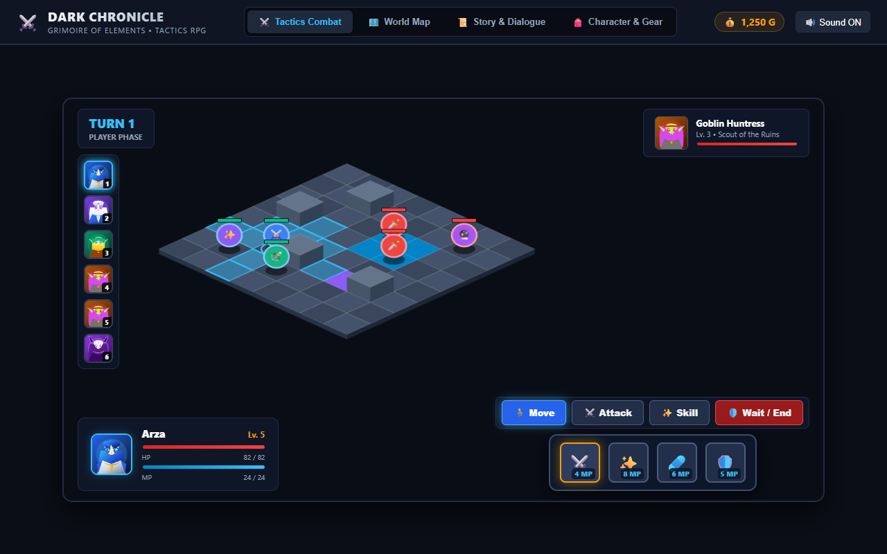

# ⚔️ Dark Chronicle: Grimoire of Elements

A dark fantasy 2D Isometric Turn-Based Tactics RPG for the web.



## 🌟 Features
- **Deterministic tactical combat**: One move and one action per heroine, in either order. Free adjacent basic attacks, BFS movement, legal spawn placement, damage previews, timed buffs, poison, elemental affinities, critical shots and lifesteal.
- **Role-based enemies**: Ranged enemies cast their skills; Morgana marks an area a full player round before releasing her attack. Victory, defeat, retry and retreat are supported.
- **Board-first presentation**: Distinct procedural humanoid class sprites with idle, movement, attack, cast, hurt and death animation. Touch coordinates and canvas sizing adapt to mobile screens.
- **All-Female Fantasy Cast**:
  - **Arza**: Knight of the Sunlit Blade (Grand Vanguard)
  - **Lyria**: Astral Archmage (Priestess of Starlight)
  - **Selenis**: Windstalker Ranger (Elven Scout)
  - **Goblin Huntress & Shadow Sorceress**: Antagonist skirmishers and dark occultists
  - **Empress Morgana**: Mistress of the Abyssal Void (Boss)
- **Interactive World Map**: Eight connected regions, including six different battle maps. Travel validates roads, level requirements and campaign unlocks. Clear Ruins and Eldertree and reach level 7 to unlock the Abyssal Rift.
- **Story & Dialogue (Visual Novel Style)**: Expressive vector anime portraits, speaker tags, chapter cutscenes.
- **Shared campaign state**: Gold, party HP/MP, per-hero equipment ownership, consumables, XP/levels and actual victory loot. Equipment derives from base stats without cumulative inflation; HP and speed bonuses apply.
- **Local saves**: Versioned browser storage with corrupt-save fallback and nonfatal storage errors. Equipment, travel and encounter outcomes autosave. Capital recovery is free; harbor recovery costs 50 gold.
- **Web Audio API Sound Engine**: Procedural synthesizers for sword slashes, arcane spells, holy heals, and victory fanfares. Zero external audio asset dependencies.

## 🛠️ Tech Stack
- TypeScript
- HTML5 Canvas & SVG Rendering
- Vite
- Deployed on Vercel

## 🚀 Getting Started

```bash
# Install dependencies
npm install

# Run development server
npm run dev

# Build for production
npm run build

# Preview build
npm run preview

# Unit/rules tests, TypeScript and production build
npm run verify

# Browser integration tests (first install the isolated test browser)
npx playwright install chromium
npm run test:e2e
```

## Controls and campaign flow

- Click/tap a blue tile to move; select Attack or a skill, then a living target. Range-0 skills target the caster.
- `M`: move, `A`: basic attack, `1`–`4`: skills, `Space`/`Enter`: end the current heroine's turn, `Esc`: cancel. Story dialogue also supports Space/Enter.
- Each heroine can move once and act once. Hover a target to inspect cost, exact damage and elemental multiplier. Enemy turns lock player actions.
- Use **Retreat to map** to leave combat, recover at Ravenhold, change gear or use potions. Inventory is read-only during an unresolved encounter.
- Defeat offers a retry from the pre-battle formation or return to the capital. A saved fallen team can recover after reloading.
- Rewards are 350 gold, 600 XP per heroine and an Ancient Element Shard per completed encounter. The reward callback cannot pay twice for the same battle.

## Save behavior and current scope

Saves are local to the current browser/origin under `grimoire-of-elements.save` (version 1). They are not cloud accounts. An unresolved encounter is not serialized: reloading restarts the opening encounter before the first clear, or returns an established campaign to its saved map position. A manual Save during combat saves the campaign, not intermediate battle actions.

Physical attacks use ATK; elemental skills use MATK. Matching elements resist damage, and weakness multipliers appear in the preview. DEF and haste expire after two owner turns; poison deals 6 damage for three owner turns. Speed is an effective equipment/status stat; turn order remains party order, not a speed initiative system.

The Firestorm scroll is explicitly disabled in inventory without consumption; combat consumable casting is not implemented. Character visuals are procedural class sprites, not a commissioned/AI-generated anime sprite pack. Story remains the existing first chapter. GitHub Actions runs unit checks, build and browser tests on pushes and pull requests.
